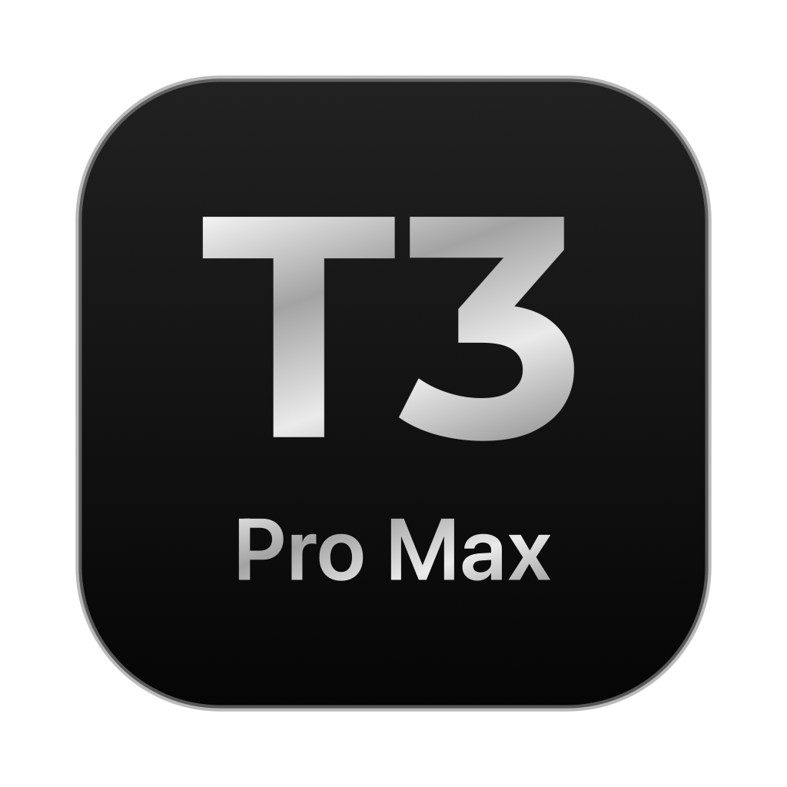

<p align="center"></p>

# T3 Code Pro Max

The T3 Code desktop app shows one window. T3 Code Pro Max gives you as many as you want.

Put one thread on your laptop and another on the external display. Keep a review open beside the build it is reviewing. Every window is a full T3 Code client with its own thread, its own project filter and its own zoom, and every window comes back where you left it when you reopen the app.

It is a small native Mac app (Swift and WebKit) that runs next to the T3 Code desktop app. Once it is installed there is nothing to configure: open it and your threads are there.

> An unofficial companion, not made by or affiliated with the T3 Code team. It uses T3 Code's own pairing and its own web client, and it does not change T3 Code. Built by [Andrés Campos](https://github.com/andresCamp). Tested with T3 Code 0.1.1 nightly of 18 October 2026.

## What it does

- **Many windows.** Click **+** after the tabs in the title bar. Each window pairs with T3 Code by itself. You never see a pairing link or a QR code.
- **Tabs in the title bar.** Every window shows one tab per open window, named by its project with the project's icon, and its own tab raised. Click a tab to bring that window forward, on any display or Space, or its × (on hover) to close it. When the tabs don't fit, they scroll sideways and the window's own tab stays in view. The first tab, **T3 Code**, always takes you to the T3 Code app.
- **New windows open ready.** The app keeps the next window paired and loaded out of sight, so **+** shows T3 Code at once. A window that has to load shows a quiet loading screen until the page is drawn, never a half-loaded page.
- **Each window keeps its own state.** Its project filter, sidebar, panels and drafts are separate from every other window's. Change the filter in one window and the others stay as they are.
- **Windows come back.** Quit and reopen, and every window returns on the same display, at the same size, on the same thread, with the same filter and zoom.
- **The title is the project.** A window filtered to a project is titled with that project's name, so the Window menu and the Dock tell your windows apart.
- **Mission Control shows the project.** Open Mission Control (F3 on most Mac keyboards) and each window shows its project's icon and name over a blurred page, so you can pick the right one at a glance. It disappears as soon as you choose.
- **Zoom per window.** The zoom control in the title bar goes from 50% to 200%. Click the percentage to reset to 100%.
- **Agents can arrange windows.** A built-in MCP server lets Claude Code, Codex or any MCP client open, move, tile, zoom and screenshot windows (see below).

## Requirements

- macOS 14 (Sonoma) or later.
- The T3 Code desktop app, installed and running. T3 Code Pro Max connects to the server inside it.

## Install

A signed download is coming. Until then, build it from source:

```sh
brew install xcodegen
git clone https://github.com/andresCamp/t3-pro-max.git
cd t3-pro-max
xcodegen generate
xcodebuild -project T3ProMax.xcodeproj -scheme T3ProMax -configuration Release \
  -derivedDataPath build CODE_SIGN_IDENTITY=- CODE_SIGN_STYLE=Automatic DEVELOPMENT_TEAM=
cp -R "build/Build/Products/Release/T3 Code Pro Max.app" /Applications/
```

This needs Xcode. The `CODE_SIGN_IDENTITY=-` setting signs the app for your own Mac only.

Then open **T3 Code Pro Max**. If T3 Code is not running, the window says so and offers to open it, then connects by itself.

## How it works

1. **Finding T3 Code.** The T3 Code desktop app runs a local server and writes its address to `~/.t3/userdata/server-runtime.json`. The app reads that file, so it follows T3 Code to whatever port it uses.
2. **Pairing.** For each window, the app runs `t3 pair`, the command the T3 Code desktop app installs in `~/.t3/bin`. It creates a one-time pairing link, and the window signs in with it in the background. In T3 Code's settings each window appears as a connection named "T3 Code Pro Max" with a short id. There is always one more connection than open windows: the window the app keeps ready for the next new window. A connection has the same access as T3 Code's own window, and you can revoke it there at any time.
3. **Separate state.** Each window has its own WebKit storage, so T3 Code treats it as a separate browser. That storage stays on your Mac in `~/Library/WebKit/com.andrescampos.t3promax`.
4. **Closing.** Closing a window with its close button signs out its connection in T3 Code and deletes its storage. Quitting the app (Cmd+Q) keeps every open window, so they all come back. If the app stops before a window can clean up after itself, the next launch signs out every connection and deletes all storage that no open window uses.
5. **Project name.** T3 Code labels its project filter button "Filter threads by project: owner/name". A small script in each window reads that label and sends it to the app, which uses it for the window title and for Mission Control. If a T3 Code update changes the label, windows fall back to the title "T3 Code Pro Max" and everything else keeps working.

The app is not sandboxed, because the sandbox would block it from reading T3 Code's address file and running the `t3` command. The app connects only to the T3 Code server on your Mac. The page inside each window is T3 Code's own web client, unchanged.

## Uninstall

1. Quit the app and delete `/Applications/T3 Code Pro Max.app`.
2. Delete `~/Library/Application Support/T3 Code Pro Max` and `~/Library/WebKit/com.andrescampos.t3promax`.
3. In T3 Code's settings, revoke the connections named "T3 Code Pro Max".

## Let agents control the windows (MCP)

The app includes an MCP server at `T3 Code Pro Max.app/Contents/MacOS/t3pm-mcp`. Register it once.

Claude Code:

```sh
claude mcp add t3-pro-max --scope user -- "/Applications/T3 Code Pro Max.app/Contents/MacOS/t3pm-mcp"
```

Codex:

```sh
codex mcp add t3-pro-max -- "/Applications/T3 Code Pro Max.app/Contents/MacOS/t3pm-mcp"
```

Its tools:

| Tool | What it does |
|---|---|
| `list_windows` | Every window: id, title, thread, project filter, display, size, zoom, and which one is in front |
| `open_window` | A new window, optionally on a thread (`thread_id`) and on a display (`screen`, 0 is the main display) |
| `navigate_window` | Shows a thread or page in an existing window |
| `focus_window` | Brings a window to the front |
| `zoom_window` | Zooms out (-1), in (1) or back to 100% (0) |
| `arrange_windows` | Tiles the windows on each display, in columns or a grid |
| `close_window` | Closes a window and signs out its connection |
| `snapshot_window` | Returns a screenshot of a window, with no Screen Recording permission needed |

An agent running inside T3 Code can combine these with T3 Code's own tools: list threads there, then open the ones you need here, one per display.

If the app is not running, the first tool call opens it.

## Build notes

- `project.yml` is the source of the Xcode project. Run `xcodegen generate` after changing it. The generated project is not committed.
- `swift scripts/make-icon.swift` redraws the icon. The "T3" is T3 Code's own icon mark (`assets/t3-mark.svg`, from [pingdotgg/t3code](https://github.com/pingdotgg/t3code), MIT). "Pro Max" is set in SF Pro.
- `App/` is the app, `MCP/` is the MCP server, and `Resources/page-bridge.js` is the script that runs inside each window.

## License

MIT. See [LICENSE](LICENSE).
